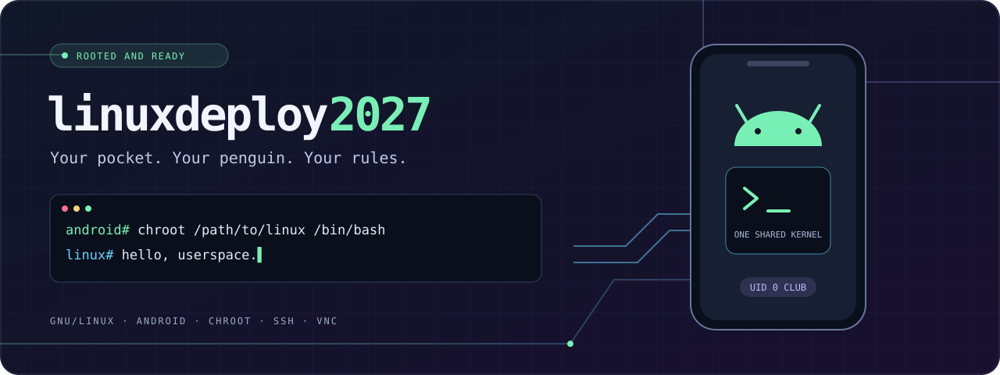
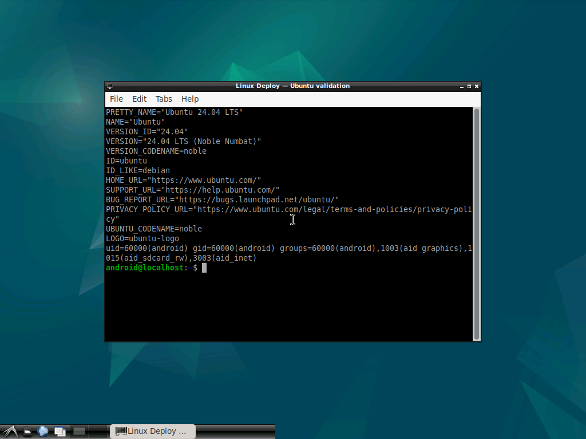
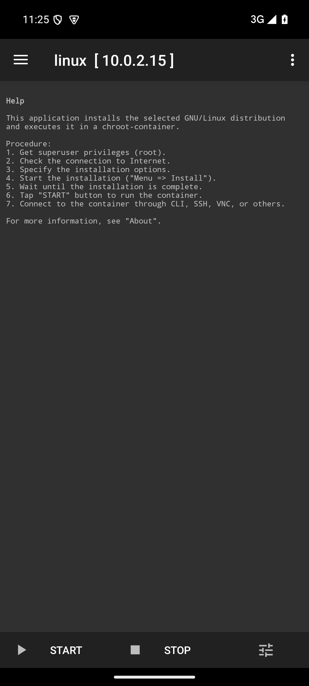

<p align="center">
  
</p>

<h1 align="center">linuxdeploy2027</h1>
<p align="center"><strong>Your pocket. Your penguin. Your rules.</strong></p>
<p align="center">A GNU/Linux userspace on your rooted Android device. Bring your own shell obsession.</p>

<p align="center">
  <a href="https://github.com/groxaxo/linuxdeploy2027/releases"></a>
  <a href="https://github.com/groxaxo/linuxdeploy2027/actions/workflows/android.yml"></a>
  <a href="LICENSE"></a>
  
</p>

<p align="center">
  <a href="#boot-sequence">Install</a> ·
  <a href="#choose-your-userspace">Distributions</a> ·
  <a href="#screens-or-it-didnt-happen">Screenshots</a> ·
  <a href="#build">Build from source</a> ·
  <a href="docs/VALIDATION.md">Validation notes</a>
</p>

## Small device. Big terminal energy.

Turn a rooted Android phone or tablet into a portable Linux workbench.
linuxdeploy2027 installs a GNU/Linux filesystem in a **chroot**, with Android's
kernel doing the heavy lifting. Fire up SSH, tinker with packages, or connect to
a graphical desktop over VNC. Termux is **not required**.

- **Shell people welcome.** A Linux userspace for command-line tools, scripts and experiments.
- **Desktop optional.** Configure SSH, VNC and a desktop when your project wants pixels.
- **Pick your habitat.** Use a disk image or a directory on a suitable Linux filesystem.
- **Modern Ubuntu on the menu.** Ubuntu 26.04 LTS (`resolute`) joins 24.04 and 22.04.
- **Batteries in the APK.** Vendored CLI tools and bundled zstd extraction for modern Ubuntu packages.

> **Root is part of the deal.** You need Android 5.0+, a working root manager,
> and a kernel/root policy that permits mounts and chroot. The chroot shares the
> Android kernel; it does not boot a separate kernel or run systemd as PID 1.

## Boot sequence

**[Download the signed APK →](https://github.com/groxaxo/linuxdeploy2027/releases)**

Allow installation from that source, open Linux Deploy, and grant your root
manager's superuser request.

1. Open **Properties** and check distribution, release, architecture and installation path.
2. Choose your storage. Use a **disk image for shared storage**. A directory install
   needs Unix permissions on a Linux filesystem, such as a dedicated directory under `/data/local`.
3. Enable **SSH** or a **graphical desktop** if wanted, then set your ports and credentials.
4. Choose **Menu → Install** and let the bootstrap finish.
5. Tap **START**, connect over SSH/VNC, and make yourself at home. Tap **STOP** before removing an image.

Fresh profiles default to **Ubuntu 24.04 LTS (`noble`)**, the native architecture
and the official Ubuntu mirror. Existing profiles keep their settings.
To try 26.04 LTS, choose **Ubuntu → resolute** in Properties using a fresh profile
and a separate installation path.

**Upgrading from an older APK?** The 2.6.1 release uses a new signing key and
cannot update the old `ubunapk` v1.0.2 APK in place. Export your profiles and
preserve container files before uninstalling that older app.
[Read the signing and installation notes](docs/VALIDATION.md#signing-and-installation-compatibility).

## Choose your userspace

### Ubuntu LTS roster

| Release | Suite in Properties | Project status |
| --- | --- | --- |
| **Ubuntu 26.04 LTS — Resolute Raccoon** | `resolute` | Bootstrap, APT, SSH and stop/restart validated on an amd64 emulator; desktop not yet tested |
| **Ubuntu 24.04 LTS — Noble Numbat** | `noble` | Default; deployment, SSH and LXDE/VNC validated on an amd64 emulator |
| **Ubuntu 22.04 LTS — Jammy Jellyfish** | `jammy` | Available; optional server/desktop component loading has regression coverage |

The latest Ubuntu LTS point release is **[26.04.1](https://lists.ubuntu.com/archives/ubuntu-announce/2026-August/000326.html)**.
Point releases use the same `resolute` suite; bootstrap pulls packages from that
suite's repositories, rather than installing a point-release ISO.
See [Ubuntu's 26.04 release notes](https://documentation.ubuntu.com/release-notes/26.04/)
for upstream requirements. An upstream release does not guarantee compatibility
with an older Android kernel. Use a compatible architecture and check the
[project's tested limits](docs/VALIDATION.md#limits).

### More rabbit holes

The inherited distribution menu also includes **Alpine, Arch, CentOS, Debian,
Fedora, Kali and Slackware**, plus **Docker** and **rootfs archive** installation
choices. Older Ubuntu suites remain in the selector too. These are inherited
options: availability in the menu does not certify current mirrors, release
support or Android compatibility. Check the distribution's lifecycle before diving in.

## Screens or it didn't happen

An actual Ubuntu 24.04 LXDE session over VNC, plus the Android app that launches it.
Captured during emulator validation; these are not Ubuntu 26.04 results.

<p align="center">
  
  
</p>

## Build

Use JDK 17 or 21 and an Android SDK with platform 35 and build tools 35.0.0:

```sh
git clone https://github.com/groxaxo/linuxdeploy2027.git
cd linuxdeploy2027
export ANDROID_HOME=/path/to/android-sdk
./gradlew :app:assembleDebug :app:assembleRelease :app:lint
python3 -m unittest discover -s tests -v
```

The pinned Gradle wrapper is 8.14.3 and Android Gradle Plugin is 8.13.2.
Debug output: `app/build/outputs/apk/debug/app-debug.apk`.
Release output: `app/build/outputs/apk/release/app-release-unsigned.apk`.
Sign release APKs with a private keystore using the SDK's `apksigner`; keys and
passwords must stay outside the repository. An installed APK can only be updated
with an APK signed by the same key.

The compile SDK is modern, while target SDK stays at **28** because the app executes
its extracted tools. Raising the target requires redesigning that execution model.
This is a sideloaded root utility, not a Google Play publication build.

The CLI environment is fully vendored under `app/src/main/assets/env`; there are no
required submodules. Gradle synchronizes the maintained Ubuntu/debootstrap overrides
from `custom_env` automatically before packaging.

## Native tools and tests

The APK bundles static zstd 1.5.7 executables for ARM, ARM64, x86 and x86_64 so modern
Ubuntu `.deb` files can be extracted without another Android app. Rebuild them with:

```sh
export ANDROID_NDK_HOME=/path/to/android-ndk
bash contrib/zstd/build.sh
```

That script verifies the source archive SHA-256 and retains the upstream BSD license.
Other native tools are inherited from Linux Deploy.

On a disposable rooted emulator with working app-level `su`, run:

```sh
ANDROID_SERIAL=emulator-5554 ./gradlew :app:connectedDebugAndroidTest
```

`adb root` alone does not give applications access to `su`. The integration tests
exercise real APK asset extraction, the CLI success/failure path, bundled zstd, and
configuration round trips. Host tests exercise the actual component loader for all
four custom Ubuntu server/desktop profiles. CI builds debug/release APKs and runs
lint and the host tests; emulator results are recorded separately.

## Standing on the shoulders of penguins

Based on [Linux Deploy](https://github.com/meefik/linuxdeploy), copyright
© 2012–2019 Anton Skshidlevsky. Distributed under the [GNU GPLv3](LICENSE).
Upstream history lives in [CHANGELOG.md](CHANGELOG.md); fork changes are in
[CHANGES.md](CHANGES.md).

Found a gremlin? [Open an issue](https://github.com/groxaxo/linuxdeploy2027/issues)
with your Android version, architecture, root manager, selected suite and relevant
logs. Redact passwords and other secrets before posting.
