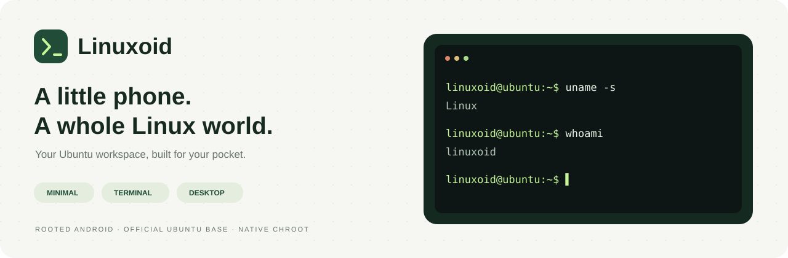
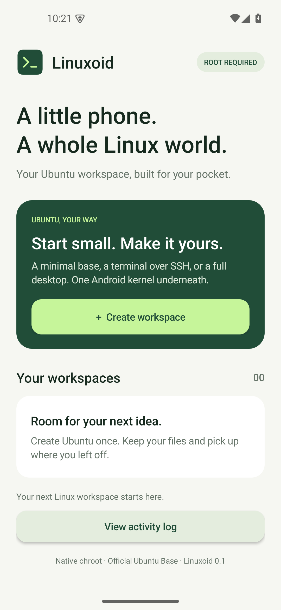
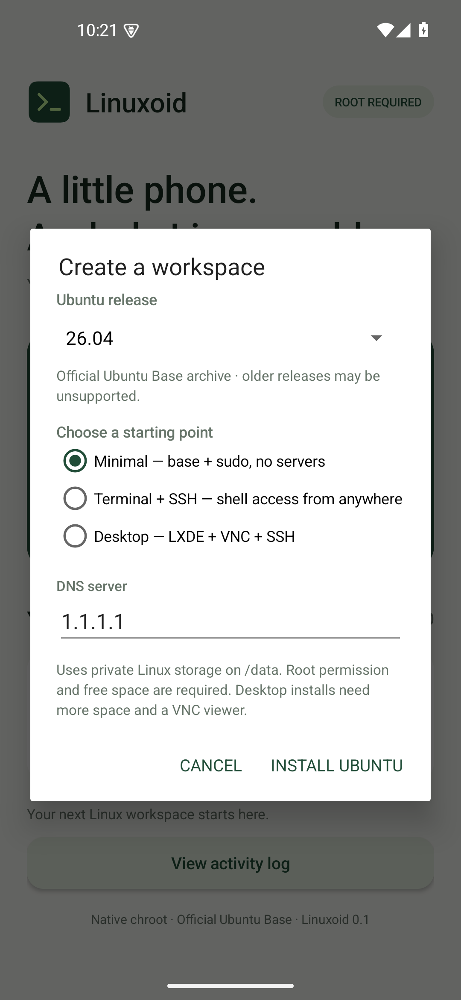
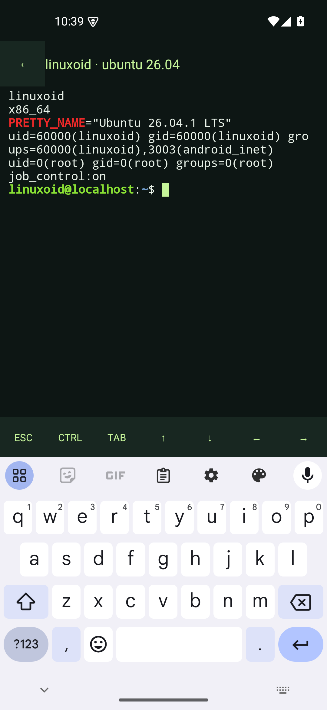
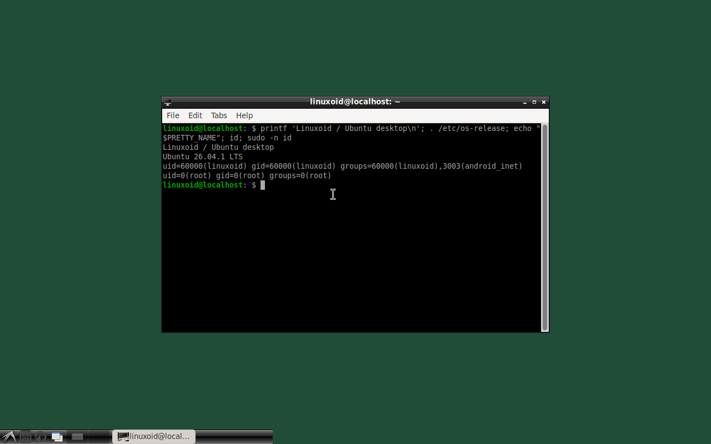

<p align="center"></p>

<h1 align="center">Linuxoid</h1>
<p align="center"><strong>Real Ubuntu. Pocket-sized possibilities.</strong></p>
<p align="center">An independent Android app for minimal, terminal and desktop Ubuntu workspaces on a rooted phone.</p>

<p align="center">
  <a href="https://github.com/groxaxo/linuxdeploy2027/actions/workflows/linuxoid.yml"></a>
  
  
  <a href="LICENSE"></a>
</p>
<p align="center"><a href="#pick-your-starting-point">Profiles</a> · <a href="#install">Install</a> · <a href="#build">Build</a> · <a href="docs/LINUXOID_VALIDATION.md">Test evidence</a> · <a href="LEGACY.md">Legacy Linux Deploy</a></p>

## A fresh shell for your next rabbit hole

Linuxoid turns a rooted Android phone into a persistent Ubuntu workbench.
Start with a small official Ubuntu Base image, open a real terminal, install
packages with APT, or launch an LXDE desktop over VNC. Your files stay in the
workspace between starts. Termux is not required.

This is a **new Android application and deployment engine**, with its own UI,
profile format, image downloader and chroot lifecycle. Its application ID is
`io.groxaxo.linuxoid`; it can coexist with Linux Deploy. The legacy app remains
in `app/` with its history and attribution intact. Linuxoid does not rename or
paraphrase its classes or CLI framework.

## Pick your starting point

| Profile | What you get |
| --- | --- |
| **Minimal** | Ubuntu Base, CA certificates, a regular Linux user, sudo and the in-app terminal. No SSH or GUI server. |
| **Terminal + SSH** | Minimal plus OpenSSH, with optional access from your local network. |
| **Desktop** | SSH plus LXDE, LXTerminal and TigerVNC. Connect a VNC viewer for the GUI. |

The terminal uses a native PTY: ANSI output, resizing, arrows, Tab, Escape and
Control input work inside the app. Desktop mode serves a genuine Ubuntu desktop;
a VNC viewer is required and is not bundled.

**Ubuntu 26.04 LTS (`resolute`), 24.04 LTS (`noble`) and 22.04 LTS (`jammy`)** are
the recommended series. The picker also reads Canonical's
[Ubuntu Base catalogue](https://cdimage.ubuntu.com/ubuntu-base/releases/) and
chooses the newest point image available for your phone's native architecture.
For 26.04, that currently includes **26.04.1 LTS**. Every image is checked against
Canonical's HTTPS SHA-256 manifest before extraction.

A listed release still needs a matching image and a compatible Android kernel.
Older entries may be unsupported or need archived mirrors. The tested combinations
and physical-device limits are recorded in [the validation report](docs/LINUXOID_VALIDATION.md).

## A look inside

<p align="center">
  
  
  
</p>

<p align="center"></p>

## Install

Linuxoid is currently a **0.1 preview**. Build the APK below or use the
`Linuxoid-apks-and-checks` artifact from [Linuxoid Actions](https://github.com/groxaxo/linuxdeploy2027/actions/workflows/linuxoid.yml).
Older APKs in the repository's Releases belong to the legacy Linux Deploy app.

1. Install the Linuxoid APK and grant your root manager's superuser request when prompted.
2. Tap **Create workspace**, choose an Ubuntu release and select Minimal, Terminal + SSH, or Desktop.
3. For SSH/Desktop, set a workspace password. Enable network SSH only if you want it.
4. Choose **Install Ubuntu**. Linuxoid downloads, checks, extracts and configures the image.
5. Open **Terminal**, or connect a VNC viewer using **Open desktop**. Use **Stop** before shutting down the workspace.

SSH uses the user `linuxoid` and the port shown on its workspace card. It listens
on localhost unless network access was selected. VNC stays on localhost; use an
SSH tunnel from another computer. VNC authentication uses the first eight
characters of the workspace password.

Workspace files live in private, separately named directories under `/data/local/linuxoid`.
Install refuses to overwrite an existing destination, and incomplete installs
retain their files. Existing Linux Deploy containers are untouched.

Ubuntu shares Android's kernel: this is a chroot, so it does not boot its own
kernel or systemd as PID 1. A functioning root manager and compatible mount,
execution and SELinux policy are required.

## Build

Use JDK 21, Android SDK 35/build-tools 35.0.0, NDK 28.2.13676358 and CMake 3.22.1:

```sh
git clone https://github.com/groxaxo/linuxdeploy2027.git
cd linuxdeploy2027
export ANDROID_HOME=/path/to/android-sdk
./gradlew :linuxoid:assembleDebug :linuxoid:assembleRelease \
  :linuxoid:testDebugUnitTest :linuxoid:lintDebug
```

Installable development APK:
`linuxoid/build/outputs/apk/debug/linuxoid-debug.apk`.
Release output is unsigned until signed with your private key.
See [Linuxoid development notes](linuxoid/README.md) for architecture, signing and
opt-in emulator tests.

## Original app. Honest dependencies.

Linuxoid's new application and engine sources use [GPLv3](LICENSE). BusyBox
remains GPLv2, xterm.js remains MIT, and Ubuntu packages keep their own licenses.
Their authorship has not been relabeled. Matching BusyBox source/configuration,
patches and build scripts are included. See [third-party notices](linuxoid/NOTICE.md).

The previous Linux Deploy documentation and upstream credits are preserved in
[LEGACY.md](LEGACY.md). Its emulator results are separate from Linuxoid's results.
